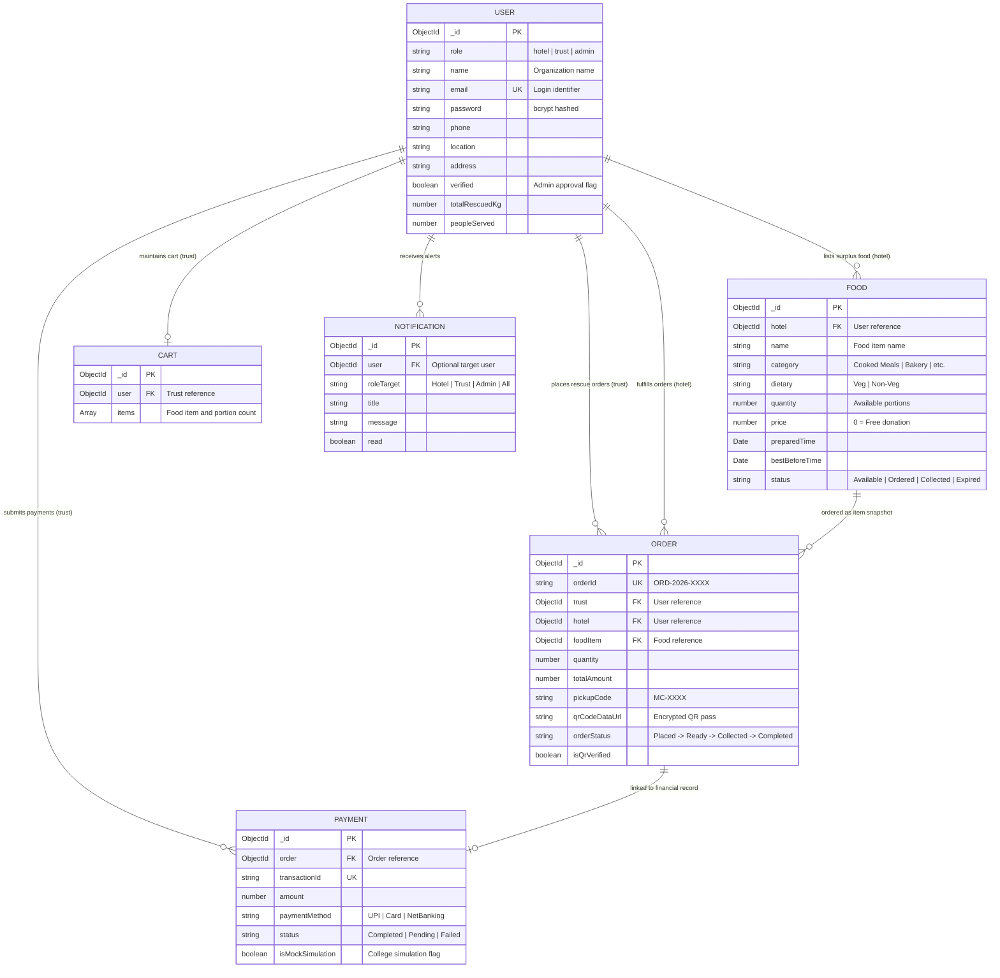

# 04 – MongoDB Database Schemas & Models

> **Meal Connect (Food Rescue Marketplace)**  
> Comprehensive documentation of the MongoDB database architecture modeled using Mongoose ODM, including schemas, relational references, indexing, automated password hashing hooks, and virtual calculations.

---

## 📑 Table of Contents
1. [Entity-Relationship Diagram](#1-entity-relationship-diagram)
2. [User Model (Hotels, Trusts, Admin)](#2-user-model-hotels-trusts-admin)
   - [`backend/models/User.js`](#backendmodelsuserjs)
3. [Food Listing Model (Surplus Inventory)](#3-food-listing-model-surplus-inventory)
   - [`backend/models/Food.js`](#backendmodelsfoodjs)
4. [Order Model (Lifecycle & QR Handover)](#4-order-model-lifecycle--qr-handover)
   - [`backend/models/Order.js`](#backendmodelsorderjs)
5. [Payment Model (Transaction Audit & Simulation)](#5-payment-model-transaction-audit--simulation)
   - [`backend/models/Payment.js`](#backendmodelspaymentjs)
6. [Cart Model (Trust Shopping Sessions)](#6-cart-model-trust-shopping-sessions)
   - [`backend/models/Cart.js`](#backendmodelscartjs)
7. [Notification Model (Multi-Role Alert System)](#7-notification-model-multi-role-alert-system)
   - [`backend/models/Notification.js`](#backendmodelsnotificationjs)

---

## 1. Entity-Relationship Diagram



---

## 2. User Model (Hotels, Trusts, Admin)

### `backend/models/User.js`

Purpose: Handles user accounts across all three platform roles (`hotel`, `trust`, `admin`). Automatically hashes passwords with `bcryptjs` using a Mongoose pre-save hook, strips password hashes from JSON serialization, and provides a password comparison helper.

```javascript
import mongoose from 'mongoose';
import bcrypt from 'bcryptjs';

const userSchema = new mongoose.Schema(
  {
    role: {
      type: String,
      required: true,
      enum: ['hotel', 'trust', 'admin'],
      default: 'trust'
    },
    name: {
      type: String,
      required: [true, 'Please provide organization or account name'],
      trim: true
    },
    email: {
      type: String,
      required: [true, 'Please provide a valid email address'],
      unique: true,
      lowercase: true,
      trim: true,
      match: [/^\S+@\S+\.\S+$/, 'Please use a valid email address']
    },
    password: {
      type: String,
      required: [true, 'Please provide a password'],
      minlength: 6,
      select: false
    },
    phone: {
      type: String,
      trim: true,
      default: ''
    },
    location: {
      type: String,
      trim: true,
      default: ''
    },
    address: {
      type: String,
      trim: true,
      default: ''
    },
    coordinates: {
      lat: { type: Number, default: 12.9716 },
      lng: { type: Number, default: 77.5946 }
    },
    ownerName: {
      type: String,
      trim: true,
      default: ''
    },
    headPerson: {
      type: String,
      trim: true,
      default: ''
    },
    regDetails: {
      type: String,
      trim: true,
      default: ''
    },
    verified: {
      type: Boolean,
      default: true
    },
    rating: {
      type: Number,
      default: 4.8
    },
    totalRescuedKg: {
      type: Number,
      default: 0
    },
    peopleServed: {
      type: Number,
      default: 0
    },
    avatar: {
      type: String,
      default: ''
    },
    accessLevel: {
      type: String,
      default: 'Standard'
    }
  },
  {
    timestamps: true,
    toJSON: {
      transform(doc, ret) {
        delete ret.password;
        return ret;
      }
    }
  }
);

// Hash password before saving
userSchema.pre('save', async function () {
  if (!this.isModified('password')) {
    return;
  }
  const salt = await bcrypt.genSalt(10);
  this.password = await bcrypt.hash(this.password, salt);
});

// Compare password method
userSchema.methods.matchPassword = async function (enteredPassword) {
  return await bcrypt.compare(enteredPassword, this.password);
};

export const User = mongoose.model('User', userSchema);
```

---

## 3. Food Listing Model (Surplus Inventory)

### `backend/models/Food.js`

Purpose: Models surplus food donations and discount listings created by hotels. Features full-text indexes for fast multi-field searching, dynamic server-side expiry calculations, and coordinates for proximity filtering.

```javascript
import mongoose from 'mongoose';

const foodSchema = new mongoose.Schema(
  {
    hotel: {
      type: mongoose.Schema.Types.ObjectId,
      ref: 'User',
      required: true
    },
    hotelName: {
      type: String,
      required: true
    },
    hotelLocation: {
      type: String,
      default: ''
    },
    name: {
      type: String,
      required: [true, 'Please enter food name'],
      trim: true
    },
    description: {
      type: String,
      trim: true,
      default: ''
    },
    category: {
      type: String,
      required: [true, 'Please select category'],
      default: 'Cooked Meals'
    },
    image: {
      type: String,
      required: [true, 'Please provide food image']
    },
    dietary: {
      type: String,
      enum: ['Veg', 'Non-Veg'],
      default: 'Veg'
    },
    quantity: {
      type: Number,
      required: [true, 'Please specify available quantity'],
      min: [0, 'Quantity cannot be negative'],
      default: 1
    },
    unit: {
      type: String,
      default: 'portions'
    },
    price: {
      type: Number,
      default: 0,
      min: [0, 'Price cannot be negative']
    },
    preparedTime: {
      type: Date,
      required: [true, 'Please specify preparation time'],
      default: Date.now
    },
    bestBeforeTime: {
      type: Date,
      required: [true, 'Please specify expiry time']
    },
    pickupLocation: {
      type: String,
      default: 'Hotel Main Gate / Front Desk'
    },
    availablePickupTime: {
      type: String,
      default: 'Immediate Pickup Available'
    },
    status: {
      type: String,
      enum: ['Available', 'Ordered', 'Collected', 'Expired'],
      default: 'Available'
    },
    distanceKm: {
      type: Number,
      default: 2.5
    },
    coordinates: {
      lat: { type: Number, default: 12.9716 },
      lng: { type: Number, default: 77.5946 }
    }
  },
  {
    timestamps: true,
    toJSON: { virtuals: true },
    toObject: { virtuals: true }
  }
);

// Dynamic check: whether item has expired based on current server time
foodSchema.methods.checkExpiry = function () {
  const now = new Date();
  if (this.status !== 'Collected' && this.bestBeforeTime && new Date(this.bestBeforeTime) <= now) {
    this.status = 'Expired';
    return true;
  }
  return false;
};

// Text indexes for search
foodSchema.index({ name: 'text', hotelName: 'text', hotelLocation: 'text' });
foodSchema.index({ status: 1, bestBeforeTime: 1, category: 1, price: 1 });

export const Food = mongoose.model('Food', foodSchema, 'fooditems');
export const FoodItem = Food;
```

---

## 4. Order Model (Lifecycle & QR Handover)

### `backend/models/Order.js`

Purpose: Tracks the order lifecycle from initial placement through hotel confirmation, preparation, pickup, and completion. Preserves food snapshots, generates 6-digit verification PINs (`MC-XXXX`), encodes QR pass Data URLs, and stores verification audit timestamps.

```javascript
import mongoose from 'mongoose';

const orderTimelineSchema = new mongoose.Schema(
  {
    status: { type: String, required: true },
    time: { type: String, default: 'Pending' },
    done: { type: Boolean, default: false }
  },
  { _id: false }
);

const pickupVerificationSchema = new mongoose.Schema(
  {
    pickupDate: { type: String, required: true },
    pickupTime: { type: String, required: true },
    orderId: { type: String, required: true },
    hotelName: { type: String, required: true },
    trustName: { type: String, required: true },
    foodItem: { type: String, required: true },
    collectedQuantity: { type: String, required: true },
    verifiedBy: { type: String, default: 'Hotel Front Desk' }
  },
  { _id: false }
);

const orderSchema = new mongoose.Schema(
  {
    orderId: {
      type: String,
      required: true,
      unique: true,
      index: true
    },
    trust: {
      type: mongoose.Schema.Types.ObjectId,
      ref: 'User',
      required: true
    },
    trustName: {
      type: String,
      required: true
    },
    hotel: {
      type: mongoose.Schema.Types.ObjectId,
      ref: 'User',
      required: true
    },
    hotelName: {
      type: String,
      required: true
    },
    hotelLocation: {
      type: String,
      default: ''
    },
    pickupLocation: {
      type: String,
      default: ''
    },
    foodItem: {
      type: mongoose.Schema.Types.ObjectId,
      ref: 'Food',
      required: true
    },
    foodName: {
      type: String,
      required: true
    },
    foodImage: {
      type: String,
      default: ''
    },
    quantity: {
      type: Number,
      required: true,
      min: 1
    },
    unit: {
      type: String,
      default: 'portions'
    },
    pricePerUnit: {
      type: Number,
      default: 0
    },
    subtotal: {
      type: Number,
      default: 0
    },
    deliveryCharge: {
      type: Number,
      default: 0
    },
    totalAmount: {
      type: Number,
      default: 0
    },
    fulfillmentType: {
      type: String,
      enum: ['pickup', 'delivery'],
      default: 'pickup'
    },
    paymentMethod: {
      type: String,
      default: 'UPI'
    },
    paymentTxnId: {
      type: String,
      default: ''
    },
    paymentStatus: {
      type: String,
      enum: ['Payment Successful', 'Pending', 'Failed', 'Refunded'],
      default: 'Payment Successful'
    },
    orderStatus: {
      type: String,
      enum: ['Order Placed', 'Hotel Confirmed', 'Food Ready', 'Picked Up', 'Delivered', 'Collected', 'Completed', 'Cancelled'],
      default: 'Food Ready'
    },
    orderDate: {
      type: Date,
      default: Date.now
    },
    estimatedDelivery: {
      type: String,
      default: 'Ready for Pickup / Verification'
    },
    notes: {
      type: String,
      default: ''
    },
    pickupCode: {
      type: String,
      required: true
    },
    qrCodeDataUrl: {
      type: String,
      default: ''
    },
    isQrVerified: {
      type: Boolean,
      default: false
    },
    pickupVerification: pickupVerificationSchema,
    timeline: [orderTimelineSchema]
  },
  {
    timestamps: true,
    toJSON: { virtuals: true },
    toObject: { virtuals: true }
  }
);

orderSchema.index({ trust: 1, createdAt: -1 });
orderSchema.index({ hotel: 1, createdAt: -1 });
orderSchema.index({ pickupCode: 1 });
orderSchema.index({ orderStatus: 1 });

export const Order = mongoose.model('Order', orderSchema);
```

---

## 5. Payment Model (Transaction Audit & Simulation)

### `backend/models/Payment.js`

Purpose: Maintains an immutable financial audit trail. Supports both college project mock payment simulation tokens and live Razorpay transaction signatures.

```javascript
import mongoose from 'mongoose';

const paymentSchema = new mongoose.Schema(
  {
    order: {
      type: mongoose.Schema.Types.ObjectId,
      ref: 'Order',
      required: true
    },
    orderId: {
      type: String,
      required: true
    },
    user: {
      type: mongoose.Schema.Types.ObjectId,
      ref: 'User',
      required: true
    },
    amount: {
      type: Number,
      required: true,
      min: 0
    },
    currency: {
      type: String,
      default: 'INR'
    },
    paymentMethod: {
      type: String,
      default: 'UPI'
    },
    transactionId: {
      type: String,
      required: true,
      unique: true
    },
    razorpayOrderId: {
      type: String,
      default: ''
    },
    razorpayPaymentId: {
      type: String,
      default: ''
    },
    razorpaySignature: {
      type: String,
      default: ''
    },
    status: {
      type: String,
      enum: ['Pending', 'Completed', 'Failed', 'Refunded'],
      default: 'Completed'
    },
    isMockSimulation: {
      type: Boolean,
      default: true
    },
    verifiedAt: {
      type: Date,
      default: Date.now
    }
  },
  {
    timestamps: true
  }
);

paymentSchema.index({ orderId: 1 });
paymentSchema.index({ user: 1, createdAt: -1 });

export const Payment = mongoose.model('Payment', paymentSchema);
```

---

## 6. Cart Model (Trust Shopping Sessions)

### `backend/models/Cart.js`

Purpose: Persists shopping cart selections for authenticated Trust users on the server, ensuring items remain synchronized across browser sessions and devices.

```javascript
import mongoose from 'mongoose';

const cartItemSchema = new mongoose.Schema(
  {
    foodItem: {
      type: mongoose.Schema.Types.ObjectId,
      ref: 'Food',
      required: true
    },
    quantity: {
      type: Number,
      required: true,
      min: [1, 'Quantity must be at least 1'],
      default: 1
    }
  },
  { _id: true }
);

const cartSchema = new mongoose.Schema(
  {
    user: {
      type: mongoose.Schema.Types.ObjectId,
      ref: 'User',
      required: true,
      unique: true
    },
    items: [cartItemSchema]
  },
  {
    timestamps: true
  }
);

export const Cart = mongoose.model('Cart', cartSchema);
```

---

## 7. Notification Model (Multi-Role Alert System)

### `backend/models/Notification.js`

Purpose: Supports targeted user notifications and broadcast alerts for specific roles (Hotels, Trusts, or Admins) when orders are placed, collected, or when urgent food becomes available.

```javascript
import mongoose from 'mongoose';

const notificationSchema = new mongoose.Schema(
  {
    user: {
      type: mongoose.Schema.Types.ObjectId,
      ref: 'User'
    },
    roleTarget: {
      type: String,
      enum: ['Hotel', 'Trust', 'Admin', 'All'],
      default: 'All'
    },
    hotelId: {
      type: String,
      default: ''
    },
    trustId: {
      type: String,
      default: ''
    },
    title: {
      type: String,
      required: true
    },
    message: {
      type: String,
      required: true
    },
    type: {
      type: String,
      enum: ['order', 'new_food', 'status', 'expiry', 'general'],
      default: 'general'
    },
    read: {
      type: Boolean,
      default: false
    }
  },
  {
    timestamps: true,
    toJSON: {
      virtuals: true,
      transform(doc, ret) {
        ret.id = ret._id.toString();
        ret.timestamp = ret.createdAt ? new Date(ret.createdAt).toLocaleTimeString([], { hour: '2-digit', minute: '2-digit' }) : 'Just now';
        return ret;
      }
    }
  }
);

notificationSchema.index({ roleTarget: 1, read: 1, createdAt: -1 });
notificationSchema.index({ user: 1, createdAt: -1 });

export const Notification = mongoose.model('Notification', notificationSchema);
```
