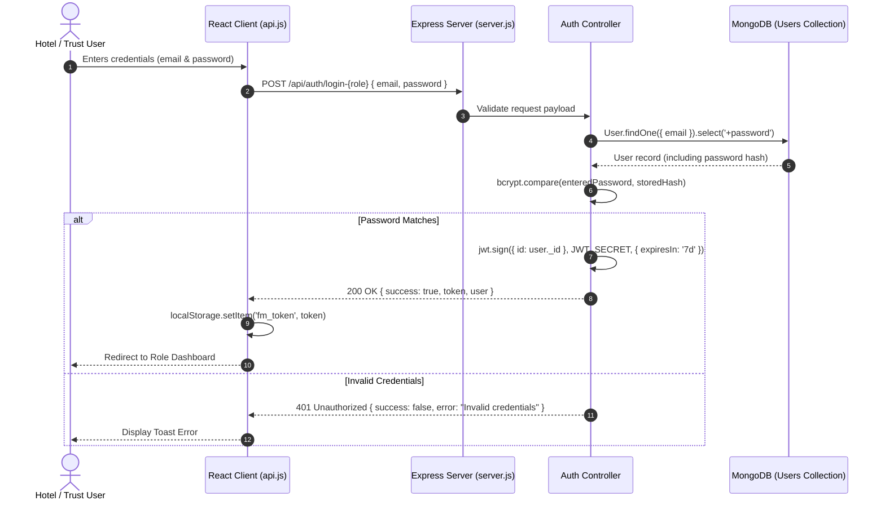

# 06 – Authentication & Role-Based Authorization

> **Meal Connect (Food Rescue Marketplace)**  
> Technical documentation of user authentication, cryptographic password hashing, JSON Web Token (JWT) lifecycle, Role-Based Access Control (RBAC), and Admin organization verification workflows.

---

## 📑 Table of Contents
1. [Authentication Architecture Overview](#1-authentication-architecture-overview)
2. [Role-Based Access Control (RBAC) Matrix](#2-role-based-access-control-rbac-matrix)
3. [Password Security & Hashing (`bcryptjs`)](#3-password-security--hashing-bcryptjs)
4. [JWT Token Lifecycle & Bearer Authentication](#4-jwt-token-lifecycle--bearer-authentication)
5. [Backend Middleware Implementation (`auth.js`)](#5-backend-middleware-implementation-authjs)
6. [Frontend Token Management & API Interception](#6-frontend-token-management--api-interception)
7. [Admin Verification Workflow for Hotels & Trusts](#7-admin-verification-workflow-for-hotels--trusts)

---

## 1. Authentication Architecture Overview

Meal Connect employs a stateless **JSON Web Token (JWT)** authentication model coupled with salted **bcrypt** password hashing. The platform segregates users into three distinct roles:
1. **Hotel / Restaurant (`hotel`)**: Can list surplus food, update quantities, view pending orders, and verify pickups using PINs or QR codes.
2. **Trust / NGO (`trust`)**: Can browse available food listings, manage a shopping cart, place rescue orders, initiate simulated payments, and generate digital pickup passes.
3. **System Administrator (`admin`)**: Can approve or revoke hotel/trust verifications, review system reports, monitor financial simulation metrics, and audit expired listings.



---

## 2. Role-Based Access Control (RBAC) Matrix

| Feature / Resource | Public / Guest | Hotel User | Trust / NGO | System Admin |
|---|:---:|:---:|:---:|:---:|
| Browse Food Marketplace | ✅ | ✅ | ✅ | ✅ |
| View Food Item Details | ✅ | ✅ | ✅ | ✅ |
| Public Impact Statistics | ✅ | ✅ | ✅ | ✅ |
| Register Hotel Account | ✅ | ❌ | ❌ | ❌ |
| Register Trust Account | ✅ | ❌ | ❌ | ❌ |
| Create Surplus Food Listing | ❌ | ✅ | ❌ | ❌ |
| Edit Own Food Listing | ❌ | ✅ | ❌ | ✅ |
| Delete Own Food Listing | ❌ | ✅ | ❌ | ✅ |
| Add Food to Rescue Cart | ❌ | ❌ | ✅ | ❌ |
| Place Food Rescue Order | ❌ | ❌ | ✅ | ❌ |
| Run Mock Payment Simulation | ❌ | ❌ | ✅ | ❌ |
| View Order Pickup Pass & QR | ❌ | ❌ | ✅ | ❌ |
| Verify Pickup PIN / Scan QR | ❌ | ✅ | ❌ | ✅ |
| View Admin Statistics | ❌ | ❌ | ❌ | ✅ |
| Toggle Organization Verification | ❌ | ❌ | ❌ | ✅ |
| Export Audit Reports (PDF) | ❌ | ❌ | ❌ | ✅ |

---

## 3. Password Security & Hashing (`bcryptjs`)

Passwords are never stored in plaintext. In `backend/models/User.js`, a Mongoose `pre('save')` hook intercepts new users or password modifications, automatically generating a cryptographic salt with 10 rounds:

```javascript
// Hash password before saving to database
userSchema.pre('save', async function () {
  if (!this.isModified('password')) {
    return;
  }
  const salt = await bcrypt.genSalt(10);
  this.password = await bcrypt.hash(this.password, salt);
});

// Compare entered password with stored hash
userSchema.methods.matchPassword = async function (enteredPassword) {
  return await bcrypt.compare(enteredPassword, this.password);
};
```

To prevent accidental password exposure in API queries, the `password` field is configured with `select: false` and stripped in the `toJSON` schema transform:

```javascript
toJSON: {
  transform(doc, ret) {
    delete ret.password;
    return ret;
  }
}
```

---

## 4. JWT Token Lifecycle & Bearer Authentication

### Token Signing
Upon successful authentication, the backend signs a JWT payload containing the user's MongoDB `ObjectId`:

```javascript
const generateToken = (id) => {
  return jwt.sign(
    { id },
    process.env.JWT_SECRET || 'meal_connect_jwt_super_secret_key_2026_antigravity_dev',
    { expiresIn: process.env.JWT_EXPIRES_IN || '7d' }
  );
};
```

### Authorization Header Format
Protected requests must provide the token in the standard HTTP `Authorization` header:

```http
Authorization: Bearer <eyJhbGciOiJIUzI1NiIsInR5cCI6IkpXVCJ9...>
```

---

## 5. Backend Middleware Implementation (`auth.js`)

The `backend/middleware/auth.js` module provides two essential guards:
1. `protect`: Validates the Bearer token, decodes the user ID, verifies the user exists in MongoDB, and attaches the user document to `req.user`.
2. `authorizeRoles(...roles)`: Reusable Higher-Order Middleware verifying that `req.user.role` matches the required permission set.

```javascript
import jwt from 'jsonwebtoken';
import { User } from '../models/User.js';

export const protect = async (req, res, next) => {
  let token;

  if (req.headers.authorization && req.headers.authorization.startsWith('Bearer')) {
    token = req.headers.authorization.split(' ')[1];
  }

  if (!token) {
    return res.status(401).json({
      success: false,
      error: 'Access denied. Authentication token missing.'
    });
  }

  try {
    const decoded = jwt.verify(
      token,
      process.env.JWT_SECRET || 'meal_connect_jwt_super_secret_key_2026_antigravity_dev'
    );
    const user = await User.findById(decoded.id);

    if (!user) {
      return res.status(401).json({
        success: false,
        error: 'User associated with this token no longer exists.'
      });
    }

    req.user = user;
    next();
  } catch (error) {
    return res.status(401).json({
      success: false,
      error: 'Invalid or expired token. Please log in again.'
    });
  }
};

export const authorizeRoles = (...roles) => {
  return (req, res, next) => {
    if (!req.user) {
      return res.status(401).json({
        success: false,
        error: 'Unauthorized. Please log in first.'
      });
    }

    if (!roles.includes(req.user.role)) {
      return res.status(403).json({
        success: false,
        error: `Forbidden. Role '${req.user.role}' is not authorized to access this resource.`
      });
    }

    next();
  };
};
```

---

## 6. Frontend Token Management & API Interception

The frontend client in `src/services/api.js` transparently extracts the token from `localStorage` (`fm_token`) and injects it into every outgoing HTTP request:

```javascript
const request = async (endpoint, options = {}) => {
  const token = localStorage.getItem('fm_token');
  const headers = {
    'Content-Type': 'application/json',
    ...(token ? { Authorization: `Bearer ${token}` } : {}),
    ...options.headers
  };

  const res = await fetch(`${API_BASE_URL}${endpoint}`, {
    ...options,
    headers
  });

  const data = await res.json().catch(() => ({}));

  if (!res.ok) {
    throw new Error(data.error || data.message || `Request failed with status ${res.status}`);
  }

  return data;
};
```

---

## 7. Admin Verification Workflow for Hotels & Trusts

To maintain food safety standards, organization legitimacy is verified before surplus food can be distributed. Administrators can toggle verification through the protected Admin routes:

```javascript
// Toggle hotel verification approval status
export const toggleHotelVerification = async (req, res, next) => {
  try {
    const hotel = await User.findOne({ _id: req.params.id, role: 'hotel' });
    if (!hotel) {
      return res.status(404).json({ success: false, error: 'Hotel not found' });
    }

    hotel.verified = !hotel.verified;
    await hotel.save();

    res.status(200).json({
      success: true,
      message: `Hotel verification status set to ${hotel.verified ? 'VERIFIED' : 'PENDING'}`,
      data: {
        id: hotel._id,
        name: hotel.name,
        verified: hotel.verified
      }
    });
  } catch (error) {
    next(error);
  }
};
```
