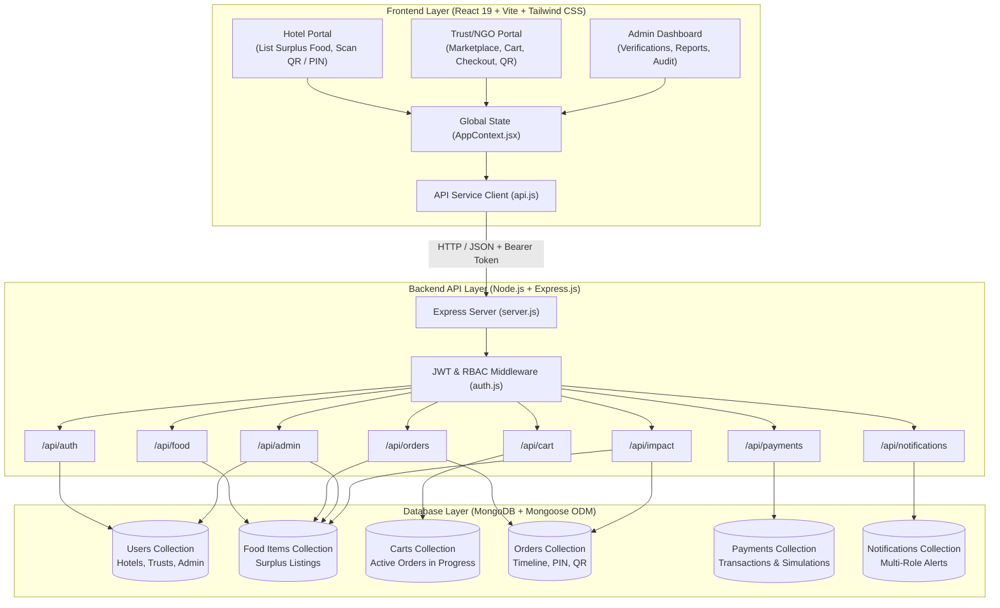

# Meal Connect – Complete Source Code & Project Documentation

> **Food Rescue Marketplace: Rescue Food, Reduce Waste, Feed Communities**  
> A production-ready, full-stack web platform connecting Hotels and Restaurants with surplus meals to verified Trusts, NGOs, and Charities via dynamic shelf-life tracking, server-side pricing, QR code and PIN pickup handover verification, mock payment simulations, and database-backed environmental impact metrics.

---

## 📚 Documentation Index

This directory contains the complete source code and technical architecture documentation for the **Meal Connect (Food Rescue Marketplace)** project, organized into separate technical modules suitable for college mini-project reports, academic submissions, and software engineering portfolios.

| Document | Title | Description |
|---|---|---|
| [**01-project-structure.md**](./01-project-structure.md) | **Project Architecture & Directory Structure** | Complete workspace directory tree, folder roles, dependencies, and file relationships. |
| [**02-frontend-code.md**](./02-frontend-code.md) | **Frontend Application Source Code** | Complete React 19 source code: Pages, Views, Components, Modals, State Context, API Service, and Utilities. |
| [**03-backend-code.md**](./03-backend-code.md) | **Backend Architecture & Controllers** | Express.js server entry point, database connection, middleware, and business controllers. |
| [**04-database-models.md**](./04-database-models.md) | **MongoDB Database Schemas & Models** | Complete Mongoose schemas for Users, Food Listings, Carts, Orders, Payments, and Notifications. |
| [**05-api-routes.md**](./05-api-routes.md) | **REST API Routes & Endpoint Specifications** | Express router source code, HTTP methods, headers, request bodies, and JSON responses. |
| [**06-authentication.md**](./06-authentication.md) | **Authentication & Role-Based Authorization** | JWT token flow, bcrypt password hashing, Hotel/Trust verification, and route security. |
| [**07-configuration-and-setup.md**](./07-configuration-and-setup.md) | **Configuration, Environment & Setup Guide** | Environment templates, build configuration, `package.json`, and step-by-step installation instructions. |
| [**08-testing.md**](./08-testing.md) | **Automated Testing & Quality Assurance** | End-to-end automated API test suite code (`test-api.js`), test results, and test cases. |
| [**09-deployment.md**](./09-deployment.md) | **Deployment & Production Architecture** | Production build guidelines, Docker containerization, cloud hosting, and security hardening. |

---

## 🏛️ System Architecture

---

## 💡 Technology Stack Summary

### Frontend Technologies
- **Core Framework**: React 19 (Hooks, Context API, Suspense, SPA routing)
- **Build Tool**: Vite 8.3
- **Styling**: Tailwind CSS v4, Vanilla CSS Design System, Responsive Glassmorphism
- **Iconography**: Lucide React Icons
- **PDF Reporting**: `jspdf`, `jspdf-autotable`, `html2canvas`
- **QR Code Engine**: `qrcode`, Canvas rendering
- **Animations**: Canvas Confetti, Micro-interactions, Transitions

### Backend Technologies
- **Runtime Environment**: Node.js (v18+)
- **Server Framework**: Express.js (Modular routers, controllers, middleware)
- **Database**: MongoDB (Local Community Server / MongoDB Atlas)
- **Object Data Modeling (ODM)**: Mongoose v9
- **Authentication**: JSON Web Tokens (`jsonwebtoken`), `bcryptjs` password hashing (10 salt rounds)
- **HTTP & CORS**: `cors`, `dotenv`, `morgan` HTTP logger
- **Payment Processing**: Dual-mode payment engine (College Mock Simulation + Razorpay API integration)

---

## 🚀 Key Functional Modules

1. **Authentication & Multi-Role Verification**:
   - Secure Hotel and Trust registration with organizational details, contact person, phone, and address.
   - Admin verification toggle to approve trusted NGOs and reputable hotels.
   - Protected Admin portal with pre-seeded administrative credentials.

2. **Food Marketplace & Dynamic Shelf-Life Engine**:
   - Surplus food creation with name, category, quantity, pricing (including ₹0 free rescue donations), preparation time, and best-before window.
   - Dynamic countdown calculation ensuring food listings show active shelf-life and automatic expiry indicators.
   - Multi-parameter filtering by category, dietary preferences (Veg/Non-Veg), proximity, and keyword search.

3. **Cart, Orders & Handover Lifecycle**:
   - Server-side order verification preventing race conditions and inventory overselling.
   - Lifecycle tracking: `Order Placed` ➔ `Hotel Confirmed` ➔ `Food Ready` ➔ `Picked Up / Collected` ➔ `Completed`.
   - Security verification via unique 6-digit pickup PINs (`MC-XXXX`) and encrypted QR codes.
   - Automatic inventory restoration if an order is cancelled.

4. **College Project Mock Payment Simulation**:
   - Free claims processed directly for ₹0 surplus food donations.
   - Simulated payment gateway supporting `success`, `failed`, and `pending` states.
   - Cryptographically safe transaction IDs without requiring real credit cards or currency deductions.

5. **Admin Reporting & Environmental Impact**:
   - Metrics computed from MongoDB collections: Total Meals Rescued, Kilograms of Food Saved, CO₂ Emissions Prevented, People Nourished.
   - Audit system for expired food listings and unverified organizations.
   - Report generator exporting audit datasets to printable PDF format.
